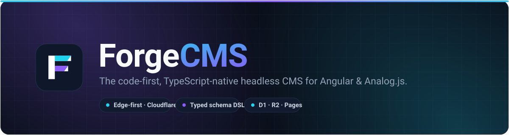

<div align="center">



<br />

**A code-first, TypeScript-native headless CMS for Angular and Analog.js — runs on Cloudflare (D1 + R2) or on plain Node (libSQL + S3).**

<br />

[](https://github.com/Andersseen/ForgeCMS/actions/workflows/ci.yml)
[](./LICENSE)
[](https://www.npmjs.com/package/@forge-cms/runtime)
[](docs/1.0-RELEASE-DOSSIER.md)

**[Documentation](https://forge-cms.pages.dev/docs)** · **[Server quickstart](apps/www/src/content/docs/server-quickstart.md)** · **[Angular quickstart](apps/www/src/content/docs/angular-quickstart.md)** · **[Reference](docs/REFERENCE.md)** · **[Support](docs/SUPPORT.md)** · **[Security](SECURITY.md)**

</div>

---

> [!NOTE]
> **Status.** The eleven `@forge-cms/*` packages are published as one fixed family; the current release is **`0.13.3`**. The 1.0 public
> surface is frozen ([docs/1.0-PUBLIC-SURFACE.md](docs/1.0-PUBLIC-SURFACE.md)) and the 1.0 release candidate is the next step — ForgeCMS is
> **not released as 1.0 yet**. Until then a minor release may still change the frozen surface only to fix a release blocker. What is proven, by
> which gate, and what is deliberately out of scope: [docs/1.0-RELEASE-DOSSIER.md](docs/1.0-RELEASE-DOSSIER.md) and
> [docs/LIMITATIONS.md](docs/LIMITATIONS.md).

## What is ForgeCMS?

ForgeCMS is a **code-first headless CMS for Angular and Analog.js developers**. You describe your content in TypeScript; that one
definition drives the database schema, validation, a REST API, the types your Angular app receives and the forms of a reusable admin.
There is no GUI schema builder, no code generation step and no second language.

- **Audience:** TypeScript/Node developers who want a CMS they own (server-only use is fully supported), and Angular/Analog developers who want a
  CMS that is Angular-native instead of a React admin next to their app.
- **Product inspiration:** [Payload](https://payloadcms.com) — config-as-code collections, a Local API, access functions. ForgeCMS is **not** a Payload clone and
  does not claim feature parity; it has no GraphQL, plugin system, page builder or CLI (see [limitations](docs/LIMITATIONS.md)).
- **Where it runs:** Cloudflare Pages/Workers with D1 + R2, or Node with on-disk libSQL + an S3-compatible bucket. Both profiles are built from the packed
  public packages and exercised in CI; the Cloudflare profile was also rehearsed on isolated real Cloudflare staging with a backup and an isolated restore.
  See the [deployment matrix](docs/MATRICES.md#deployment-profiles).
- **Supported baseline:** Node >= 22, pnpm 10, TypeScript 5.9 strict, Angular 21 (client also on Angular 22), Analog.js 2 — exact ranges and the versions
  actually tested are in [docs/SUPPORT.md](docs/SUPPORT.md).

## Install

Server only (no Angular, no admin):

```sh
pnpm add @forge-cms/core @forge-cms/runtime @forge-cms/db @forge-cms/auth @forge-cms/storage @forge-cms/api
```

Add what your profile needs:

```sh
pnpm add @forge-cms/cloudflare   # D1 + R2 (Cloudflare profile)
pnpm add @forge-cms/s3           # S3-compatible storage (portable profile)
pnpm add @forge-cms/angular      # typed Angular client, session, guard, signal resources
pnpm add @forge-cms/admin        # reusable Angular admin (Angular 21)
pnpm add -D @forge-cms/testing   # adapter contract suites, if you write an adapter
```

## A schema, a runtime, the Local API

```ts
import { defineCollection, defineField } from '@forge-cms/core';
import { UsersCollectionAuthAdapter, defineUsersCollection } from '@forge-cms/auth';
import { LibSqlDatabaseAdapter } from '@forge-cms/db';
import { ForgeCmsRuntime } from '@forge-cms/runtime';
import { InMemoryStorageAdapter } from '@forge-cms/storage';

const users = defineUsersCollection();
const notes = defineCollection({
  slug: 'notes',
  fields: {
    title: defineField.text({ required: true }),
    author: defineField.relation({ collection: 'users', required: true })
  },
  access: { read: () => true, create: ({ user }) => user?.role === 'admin' }
});

const database = new LibSqlDatabaseAdapter('file:./forge.db');
const auth = new UsersCollectionAuthAdapter().init({
  AUTH_SECRET: process.env.AUTH_SECRET,
  userDatabase: database
});
const runtime = new ForgeCmsRuntime({
  collections: [users, notes],
  adapters: { database, auth, storage: new InMemoryStorageAdapter() }
});

runtime.init();
await runtime.syncSchema();
const { docs } = await runtime.find({ collection: 'notes' });
```

This is a sketch; the complete, verified version (first admin, access enforced, HTTP handlers) is the
[server quickstart](apps/www/src/content/docs/server-quickstart.md). Business logic lives in the Local API; the HTTP handlers are a thin transport.

## Two ways to start

| You are…                      | Start with                                                                   | Installs                                                       |
| ----------------------------- | ---------------------------------------------------------------------------- | -------------------------------------------------------------- |
| A server/TypeScript developer | [Server quickstart](apps/www/src/content/docs/server-quickstart.md)          | core · db · auth · storage · api · runtime — no Angular at all |
| An Angular/Analog developer   | [Angular/Analog quickstart](apps/www/src/content/docs/angular-quickstart.md) | the above + `@forge-cms/angular` + `@forge-cms/admin` + peers  |

Both quickstarts are executable: `pnpm docs:verify:consumers` installs each one from the packed tarballs into a clean project and builds and runs it.

## What you get

Schema DSL with 15 field kinds (including `group`, `array`, `blocks`) · Local API and REST · function-based row and field access · the full hook
pipeline · drafts, versions with restore, globals, live preview and localization · relations with `restrict`/`cascade`/`set-null` integrity ·
browser sessions with CSRF, scoped API keys, roles · uploads through R2 or S3 · schema drift detection and reviewed migrations · backup/restore
procedures · a typed Angular client with signal resources and SSR support · a reusable Angular admin. The honest per-capability status (stable,
experimental, intentionally limited) is the [feature matrix](docs/MATRICES.md#feature-matrix).

## Packages

All eleven are versioned together (one Changesets fixed group), ESM-only, and imported only through their entry points.

| Package                                        | Purpose                                                                             |
| ---------------------------------------------- | ----------------------------------------------------------------------------------- |
| [`@forge-cms/core`](packages/core)             | Schema DSL, collection/global definitions, validation, base types                   |
| [`@forge-cms/db`](packages/db)                 | Database contract, InMemory and libSQL adapters, schema planning, migrations        |
| [`@forge-cms/auth`](packages/auth)             | Auth contract; users-collection sessions, API keys, composite/external adapters     |
| [`@forge-cms/storage`](packages/storage)       | Storage contract and InMemory adapter                                               |
| [`@forge-cms/s3`](packages/s3)                 | S3-API storage adapter (portable profile; Garage certified)                         |
| [`@forge-cms/api`](packages/api)               | `ApiContext` and handler contracts                                                  |
| [`@forge-cms/runtime`](packages/runtime)       | `ForgeCmsRuntime` (Local API) and framework-agnostic HTTP handlers                  |
| [`@forge-cms/cloudflare`](packages/cloudflare) | D1 + R2 adapters (and experimental Analytics Engine)                                |
| [`@forge-cms/angular`](packages/angular)       | Angular client SDK: `provideForgeCms`, typed client, session, guard, resources, SSR |
| [`@forge-cms/admin`](packages/admin)           | Reusable Angular admin: layout, content, auth pages, users workspace                |
| [`@forge-cms/testing`](packages/testing)       | Adapter contract suites                                                             |

Every export, option and default: [docs/REFERENCE.md](docs/REFERENCE.md).

## Deployment profiles

| Profile    | Database       | Files                                       | Evidence                                                                                                                                                            |
| ---------- | -------------- | ------------------------------------------- | ------------------------------------------------------------------------------------------------------------------------------------------------------------------- |
| Cloudflare | D1             | R2                                          | Adapter contracts · local workerd/D1/R2 · packed production consumer · **isolated real Cloudflare staging** with redeploy persistence and backup → isolated restore |
| Portable   | on-disk libSQL | `@forge-cms/s3` — Garage `v2.4.1` certified | Packed Node production server · restart persistence · upload/read/delete · backup/restore                                                                           |

AWS S3, Backblaze B2 and Wasabi are configurable but **not certified**. Staging evidence supports the framework/profile; it is not a guarantee for any
particular production deployment. A production build never silently falls back to in-memory adapters. Details: [deployment](https://forge-cms.pages.dev/docs/deployment),
[docs/STAGING-REHEARSAL.md](docs/STAGING-REHEARSAL.md), [docs/BACKUP-RESTORE.md](docs/BACKUP-RESTORE.md).

## Versions and roadmap checkpoints

Two separate numbering schemes:

- **npm versions.** The eleven packages always share one version; the latest is **`0.13.3`**. They are not the roadmap numbers.
- **Roadmap checkpoints** ([docs/ROADMAP.md](docs/ROADMAP.md)) are product guarantees (0.5 → 0.12, then the 1.0 release). Roadmaps 0.5–0.12 are
  complete; the next bounded responsibility is the 1.0 release candidate (L01 in [docs/roadmap/v1/1.0-release.md](docs/roadmap/v1/1.0-release.md)).

What is implemented right now is [docs/STATE.md](docs/STATE.md); what the 1.0 release will stand on is [docs/1.0-RELEASE-DOSSIER.md](docs/1.0-RELEASE-DOSSIER.md).

## Help, support and security

- Documentation: <https://forge-cms.pages.dev/docs> · troubleshooting: [/docs/troubleshooting](apps/www/src/content/docs/troubleshooting.md)
- Bugs and questions: [GitHub issues](https://github.com/Andersseen/ForgeCMS/issues) — see [docs/SUPPORT.md](docs/SUPPORT.md) for what is supported and the semver/deprecation policy.
- **Security problems:** do not open a public issue with exploit details — read [SECURITY.md](SECURITY.md).

## Developing this repository

```sh
git clone https://github.com/Andersseen/ForgeCMS.git
cd ForgeCMS
pnpm install
pnpm build
pnpm dev:www
```

Quality gates, the spec-driven workflow, Changesets and the CI-driven release are in [CONTRIBUTING.md](CONTRIBUTING.md), [CLAUDE.md](CLAUDE.md) and
[docs/SDD.md](docs/SDD.md). Try the [Lumea clinic demo](https://forge-cms-demo.pages.dev) (source in [`apps/demo-aesthetics`](apps/demo-aesthetics)).

## Strata

ForgeCMS does not depend on [Strata](https://github.com/Andersseen/Strata) and Strata is **not part of the ForgeCMS 1.0 API**. `apps/tiny-project` installs the
published Strata packages as an external consumer to dogfood them; Forge owns CMS behaviour. Strata Server Components are not used and are not a 1.0 feature.

## License

[MIT](./LICENSE) © ForgeCMS contributors
